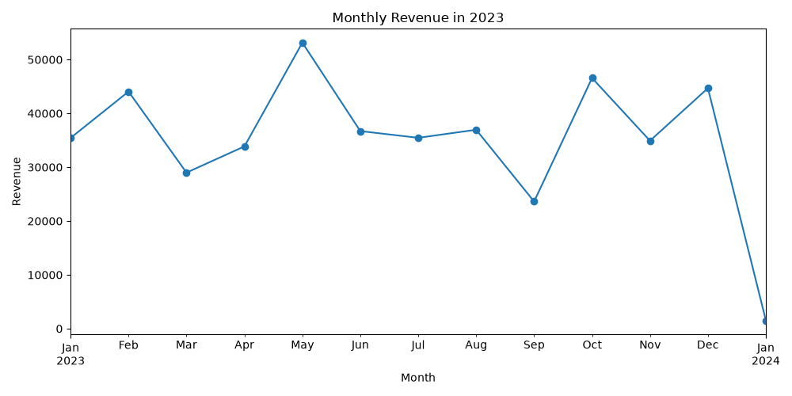
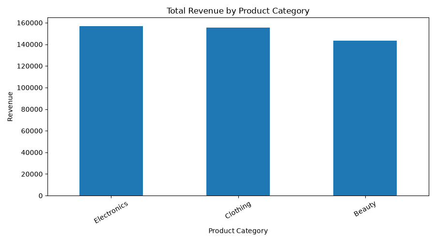
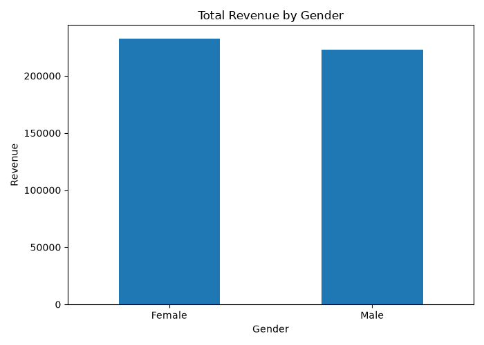

# Retail Sales Analysis

## Project Overview

This project analyzes retail sales data using Python to understand revenue trends, product category performance, and customer purchasing patterns.

## Tools Used

- Python
- Pandas
- Matplotlib

## Key Results

- Total revenue: 456,000
- Average transaction amount: 456
- Highest-revenue category: Electronics (156,905)
- Lowest-revenue category: Beauty (143,515)

## Visualizations

### 1. Monthly Revenue

### 2. Revenue by Product Category

### 3. Revenue by Customer Gender

## Project Files

- `main.py`: Main analysis code
- `retail_sales_dataset.csv`: Dataset
- `create_report.py`: Report-generation code
- `Retail_Sales_Analysis_Report.docx`: Detailed report
- `results/`: Data visualization charts

## How to Run

Install the required libraries:

`pip install pandas matplotlib`

Run the project:

`python main.py`

## Author

Sinda Hachem

## GitHub

https://github.com/sindahachem-cmyk/retail-sales-analysis
